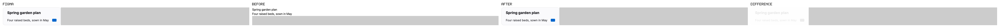
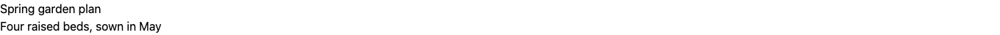
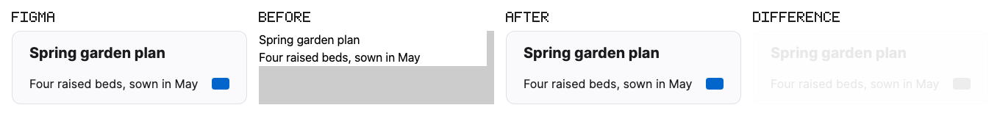
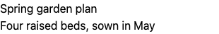
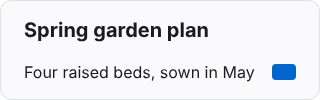
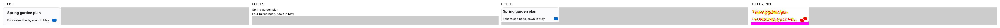
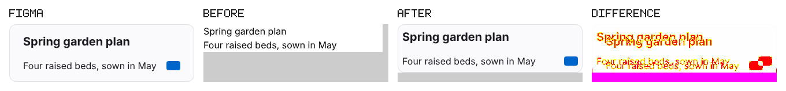

## Vertical slice evidence (NWS-2965)

One token snapshot -> one component -> before/after evidence, on a **synthetic** Figma file and a sample React + Tailwind v4 app.

> **Figma render is a stand-in.** STAND-IN, not a Figma export: figma/standin/index.html re-draws node 1:1 of figma/card-file.json from its raw values in plain CSS and is captured with figmog-shot in the same Chromium as the app. No Figma access was used. The high "after" score is therefore expected by construction; it shows the pipeline works, not fidelity to a real Figma raster.

| | 1440 px | 390 px |
| --- | --- | --- |
| before (baseline placeholder) | 9.98 | 41.02 |
| **after (correct card)** | 100.00 | 100.00 |
| broken card (wrong padding) | 75.24 | 75.24 |

Score: advisory, `100 * (1 - mismatched / (W*H))` against the Figma render; never a pass/fail gate.

### 1440 px: Figma | before | after | difference

Figma:  before:  after:  difference: 

### 390 px: Figma | before | after | difference

Figma:  before:  after:  difference: 

### Broken card (wrong padding), for contrast

1440 px: 

390 px: 

### Identity

- Figma file: `examples/slice/figma/card-file.json` "Synthetic card (vertical slice)", version **4243** (mirrored with `figmog pull --from-file`)
- Figma render: stand-in for version 4243, `examples/slice/figma/card-render.json`
- Token snapshot: `tests/fixtures/spec/variables.json` digest `fnv1a64:fd631e535712b153` (exported_at 2026-11-02T09:00:00Z)
- Token CSS: `examples/slice/app/src/tokens.css` sha256 `06d51aab01d30d9b`
- Build `before`: card `examples/slice/app/baseline/Card.jsx`, commit `63ef8a344834`, tree sha256 `1903f5cdc1899e48` (8 files)
- Build `after`: card `examples/slice/app/src/Card.jsx`, commit `63ef8a344834`, tree sha256 `3455ed7a112be4f5` (8 files)
- Build `broken`: card `examples/slice/app/variants/Card.wrong-padding.jsx`, commit `63ef8a344834`, tree sha256 `86ceccf29172a727` (8 files)
- Contract: viewports 1440x900, 390x844; light mode, default state, local only; selector `[data-testid="slice-card"]`
- Full record: `examples/slice/evidence/evidence.json`
